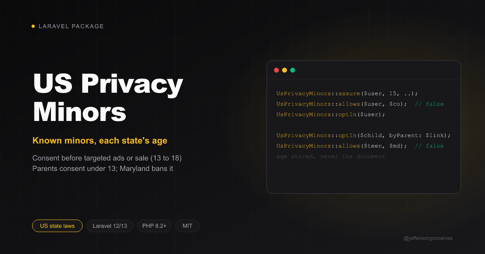

# Laravel US Privacy Minors



[](https://packagist.org/packages/jeffersongoncalves/laravel-us-privacy-minors)
[](https://github.com/jeffersongoncalves/laravel-us-privacy-minors/actions/workflows/tests.yml)
[](https://packagist.org/packages/jeffersongoncalves/laravel-us-privacy-minors)

Minors under the US state privacy laws, on top of [laravel-us-privacy](https://github.com/jeffersongoncalves/laravel-us-privacy). Every state treats the data of a known child under 13 as sensitive, processed only with a parent's consent (COPPA). Many go further for **targeted advertising and sale** of the data of known minors:

| Minors under | States | Rule |
|---|---|---|
| 18 | Colorado, Connecticut, Montana, Delaware | consent |
| 18 | Maryland | prohibited |
| 17 | New Jersey | consent |
| 16 | Oregon, New Hampshire, Minnesota | consent |
| 13 | the others | parental consent (COPPA) |

The ages come from laravel-us-privacy's state rules (`minor_age`, `minor_rule`), so overriding them there changes this package too.

> This package gives you tooling. It does not make you compliant on its own.

## Installation

```bash
composer require jeffersongoncalves/laravel-us-privacy-minors
php artisan vendor:publish --tag="us-privacy-minors-migrations"
php artisan vendor:publish --tag="us-privacy-minors-config"
php artisan migrate
```

## Age assurance

```php
use JeffersonGoncalves\UsPrivacyMinors\Enums\AssuranceMethod;
use JeffersonGoncalves\UsPrivacyMinors\Facades\UsPrivacyMinors;

UsPrivacyMinors::assure($user, 15, AssuranceMethod::StoreSignal); // store the age, never the document
UsPrivacyMinors::age($user);             // 15; reliable results outweigh self-declaration
UsPrivacyMinors::isVerifiedAdult($user); // false
```

`Route::middleware('us-privacy.adult')` lets only users with a reliable adult result through (or redirects to `verify_route`).

## Consent for targeted advertising and sale

```php
use JeffersonGoncalves\UsPrivacy\Facades\UsPrivacy;

$rules = UsPrivacy::rulesForRequest($request);  // the visitor's state law
UsPrivacyMinors::allows($user, $rules);         // false: 15 in Colorado, no consent
UsPrivacyMinors::optIn($user);                  // the minor consents (13 or over)
UsPrivacyMinors::optIn($child, byParent: $link); // under 13: a verified parent
UsPrivacyMinors::revokeOptIn($user);
```

```php
$link = UsPrivacyMinors::link($child, $mother, 'mother');
$link->verify();
UsPrivacyMinors::guardians($child);
```

In Maryland no consent helps under 18. A minor's own consent stops counting if they turn out to be under 13. Combine `allows()` with [laravel-us-privacy-opt-out](https://github.com/jeffersongoncalves/laravel-us-privacy-opt-out), which handles adults' opt-outs:

```blade
@usPrivacyMinorAllowed
    {{-- ad pixel --}}
@endusPrivacyMinorAllowed
```

```bash
php artisan us-privacy:minors --state=CT   # minors without consent under Connecticut's law
```

`treat_unknown_as_minor` treats users with no age result as under 13, for services directed to children.

## Testing

```bash
composer test
```

## Changelog

See [CHANGELOG](CHANGELOG.md).

## License

The MIT License (MIT). See [License File](LICENSE.md).
